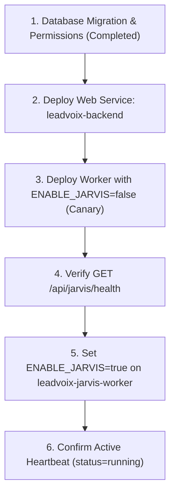

# LeadVoix Business JARVIS — Production Deployment & Rollback Runbook (Step 6)

> **Document Version**: 1.1.0  
> **Target System**: LeadVoix OS — Phase B Autonomous Background Orchestrator  
> **Author**: LeadVoix Engineering / Founder Operations  
> **Status**: Verified Staging Implementation; Production Deployment Runbook  
> **Verification Baseline**: Verified on Local PostgreSQL 18.6 Staging Harness (Step 5, Run `20261112_194204_94acc8f8`)

---

## Executive Summary & System Boundaries

LeadVoix Business JARVIS is an autonomous 24/7 background intelligence and digest system designed to operate in strict isolation from the primary LeadVoix SaaS application (customer CRM, authentication, Twilio AI voice agents, and call processing workers).

### Verified Architectural Boundaries
1. **Schema Boundary**: All JARVIS operational state resides exclusively in the dedicated `jarvis` database schema (`jarvis.jarvis_tasks`, `jarvis.audit_logs`, `jarvis.dispatch_idempotency`, `jarvis.task_attempts`, `jarvis.approval_records`). The customer SaaS schema (`public`) is never written to by JARVIS.
2. **Process Boundary**: The JARVIS orchestrator worker runs as an independent Render background worker (`leadvoix-jarvis-worker`) executing `python -m backend.app.workers.jarvis_worker process`. It shares no threads, event loops, or memory with the Twilio call worker (`leadvoix-call-worker`).
3. **Role & Privilege Boundary**: 
   - `leadvoix_migrator`: Owns schema `jarvis` and executes Alembic DDL. Has `CONNECT` only on the database (no database-level `CREATE`) and zero access to customer data tables.
   - `jarvis_business_reader`: Has read-only access to approved non-PII columns across 6 collector tables in `public`. Zero access to `public.users` or call audio recordings.
   - `jarvis_operator`: Authenticates the 24/7 worker. Has zero access to `public` schema and operational DML on `jarvis` queue tables. Append-only trigger enforcement on `jarvis.audit_logs`.

> [!IMPORTANT]
> **Staging vs. Production Distinction**:
> While all database roles, triggers, migration scripts, and multi-process queue concurrency have been 100% verified on a local PostgreSQL 18.6 staging cluster, production deployment introduces cloud network latencies, live Twilio webhook traffic, and external Telegram endpoints. This runbook details the exact safeguards required to safely bridge staging verification into production.

---

## 1. Production Preflight & Database Backup Verification

Before executing any database commands or modifying production configuration, complete every item in this preflight checklist.

### A. Secure Credential Handling
- **Never pass passwords in plaintext shell command arguments** (e.g. avoid `psql -W` with shell variables visible in `ps` output).
- Use a temporary `.pgpass` file with strict permissions (`chmod 0600 ~/.pgpass`) or environment variable `PGPASSWORD` within a protected subshell:
  ```bash
  # Format: hostname:port:database:username:password
  export PGPASSWORD="<PROD_ADMIN_PASSWORD>"
  ```
- Alternatively, use cloud CLI secret injection (e.g. Supabase CLI or Render Secrets).

### B. Point-In-Time-Recovery (PITR) & Manual Snapshot
Verify that automated WAL archiving and PITR are active in the production database dashboard (Supabase or Render PostgreSQL). Then define an explicit backup filename variable and execute a manual compressed pre-deployment dump:

```bash
# Define explicit, unambiguous backup filename
BACKUP_FILE="leadvoix_prod_pre_jarvis_backup_$(date +%Y%m%d_%H%M%S).dump"

pg_dump -h <PROD_DB_HOST> -p <PROD_DB_PORT> -U <PROD_ADMIN_USER> -d <PROD_DB_NAME> \
  --format=custom --no-owner --no-privileges \
  --file="${BACKUP_FILE}"
```

### C. Backup Integrity Verification
Immediately verify that the generated backup file is non-empty and structurally intact:

```bash
# 1. Verify file size is greater than zero
test -s "${BACKUP_FILE}" && echo "Backup file exists and is non-empty"

# 2. Verify Table of Contents can be read by pg_restore
pg_restore --list "${BACKUP_FILE}" | grep -E "TABLE DATA|SCHEMA" > /dev/null && echo "Backup structure valid"
```

### D. Backup Retention Policy
- Retain the pre-deployment snapshot for at least **30 days**.
- Copy the snapshot file (`${BACKUP_FILE}`) to an encrypted off-server object storage bucket (e.g., AWS S3 or Cloudflare R2 with server-side AES-256 encryption).

### E. Active Alembic Revision Verification
Connect to production as an administrator and verify that core SaaS migrations are up-to-date at revision `3c8d1e2f4a5b`:

```sql
SELECT version_num FROM public.alembic_version;
```
*Expected Output*: Exactly `3c8d1e2f4a5b`.

> [!CAUTION]
> If `public.alembic_version` is NOT `3c8d1e2f4a5b`, **STOP IMMEDIATELY**. Do not proceed with JARVIS migration until customer SaaS migrations are cleanly applied.

---

## 2. Database Migration & Role Deployment Sequence

Execution of Phase B database hardening follows a mandatory 3-stage protocol:

```
[ Stage A: Privileged Bootstrap ] --> [ Stage B: Alembic DDL ] --> [ Stage C: Trigger Hardening ]
  (Database Superuser / DBA)          (leadvoix_migrator)             (Database Superuser / DBA)
```

### Stage A: Privileged Role Setup & Schema Bootstrap (DBA / Superuser)
Execute **Part 1** of `scripts/jarvis_phase_b_roles_and_schema.sql` connected as the database administrator (`postgres` or `supabase_admin`).

1. Generate three cryptographically strong 32-character secrets:
   - `<STRONG_SECRET_MIGRATOR>`
   - `<STRONG_SECRET_READER>`
   - `<STRONG_SECRET_OPERATOR>`
2. Execute the role setup block:
   ```sql
   BEGIN;

   -- 1. Create dedicated least-privilege roles
   CREATE ROLE leadvoix_migrator WITH LOGIN NOINHERIT NOSUPERUSER NOCREATEDB NOCREATEROLE PASSWORD '<STRONG_SECRET_MIGRATOR>';
   CREATE ROLE jarvis_business_reader WITH LOGIN NOINHERIT NOSUPERUSER NOCREATEDB NOCREATEROLE PASSWORD '<STRONG_SECRET_READER>';
   CREATE ROLE jarvis_operator WITH LOGIN NOINHERIT NOSUPERUSER NOCREATEDB NOCREATEROLE PASSWORD '<STRONG_SECRET_OPERATOR>';

   -- 2. Grant CONNECT on active database (STRICTLY NO DATABASE-LEVEL CREATE)
   GRANT CONNECT ON DATABASE <PROD_DB_NAME> TO leadvoix_migrator;
   GRANT CONNECT ON DATABASE <PROD_DB_NAME> TO jarvis_business_reader;
   GRANT CONNECT ON DATABASE <PROD_DB_NAME> TO jarvis_operator;

   -- 3. Bootstrap isolated schema 'jarvis' and assign ownership to migrator
   CREATE SCHEMA IF NOT EXISTS jarvis;
   ALTER SCHEMA jarvis OWNER TO leadvoix_migrator;
   GRANT ALL ON SCHEMA jarvis TO leadvoix_migrator;
   REVOKE ALL ON SCHEMA jarvis FROM PUBLIC;

   -- 4. Shield customer SaaS schema 'public'
   REVOKE ALL ON SCHEMA public FROM jarvis_operator;
   REVOKE ALL ON ALL TABLES IN SCHEMA public FROM jarvis_operator;

   GRANT USAGE ON SCHEMA public TO leadvoix_migrator;
   REVOKE CREATE ON SCHEMA public FROM leadvoix_migrator;
   REVOKE ALL ON ALL TABLES IN SCHEMA public FROM leadvoix_migrator;
   GRANT SELECT, INSERT, UPDATE, DELETE ON TABLE public.alembic_version TO leadvoix_migrator;

   -- 5. Grant minimal column-level read-only access to reader (short lock timeout to prevent queueing)
   SET LOCAL lock_timeout = '3s';
   GRANT USAGE ON SCHEMA public TO jarvis_business_reader;
   REVOKE ALL ON ALL TABLES IN SCHEMA public FROM jarvis_business_reader;
   GRANT SELECT (id, name, slug, plan) ON TABLE public.organizations TO jarvis_business_reader;
   GRANT SELECT (id, organization_id, status, source, created_at) ON TABLE public.leads TO jarvis_business_reader;
   GRANT SELECT (id, organization_id, duration, status, direction, created_at) ON TABLE public.agent_calls TO jarvis_business_reader;
   GRANT SELECT (id, organization_id, status, amount, created_at) ON TABLE public.deals TO jarvis_business_reader;
   GRANT SELECT (id, organization_id, status, created_at) ON TABLE public.tasks TO jarvis_business_reader;
   GRANT SELECT (id, status, agent_call_id, created_at) ON TABLE public.call_processing_jobs TO jarvis_business_reader;

   -- 6. Schema 'jarvis' runtime access
   GRANT USAGE ON SCHEMA jarvis TO jarvis_business_reader;
   GRANT USAGE ON SCHEMA jarvis TO jarvis_operator;
   REVOKE CREATE ON SCHEMA jarvis FROM jarvis_business_reader;
   REVOKE CREATE ON SCHEMA jarvis FROM jarvis_operator;

   -- 7. Default privileges for future tables created by leadvoix_migrator
   ALTER DEFAULT PRIVILEGES FOR ROLE leadvoix_migrator IN SCHEMA jarvis GRANT SELECT, INSERT ON TABLES TO jarvis_operator;
   ALTER DEFAULT PRIVILEGES FOR ROLE leadvoix_migrator IN SCHEMA jarvis GRANT USAGE, SELECT ON SEQUENCES TO jarvis_operator;
   ALTER DEFAULT PRIVILEGES FOR ROLE leadvoix_migrator IN SCHEMA jarvis GRANT SELECT ON TABLES TO jarvis_business_reader;

   COMMIT;
   ```

### Stage B: Apply Alembic Migration (`leadvoix_migrator`)
Run Alembic upgrade using the dedicated migration role connection:

```bash
export MIGRATION_DATABASE_URL="postgresql://leadvoix_migrator:<STRONG_SECRET_MIGRATOR>@<PROD_DB_HOST>:<PROD_DB_PORT>/<PROD_DB_NAME>"

alembic upgrade 4f7e2a1b9c3d
```

> [!NOTE]
> Revision `4f7e2a1b9c3d` inspects `insp.has_schema("jarvis")`. Because schema `jarvis` was pre-bootstrapped in Stage A, it skips `CREATE SCHEMA` and builds all operational tables inside `jarvis` using schema ownership rights, with zero database-level `CREATE` privilege.

### Stage C: Post-Migration Hardening & Trigger Installation (DBA / Superuser)
Execute **Part 2** of `scripts/jarvis_phase_b_roles_and_schema.sql` connected as the database administrator:

```sql
BEGIN;

-- 1. Table permissions for jarvis_operator
GRANT SELECT, INSERT, UPDATE, DELETE ON TABLE jarvis.jarvis_tasks TO jarvis_operator;
GRANT SELECT, INSERT, UPDATE, DELETE ON TABLE jarvis.dispatch_idempotency TO jarvis_operator;
GRANT SELECT, INSERT, UPDATE, DELETE ON TABLE jarvis.task_attempts TO jarvis_operator;
GRANT SELECT, INSERT, UPDATE, DELETE ON TABLE jarvis.approval_records TO jarvis_operator;

-- 2. Audit log append-only permissions
GRANT SELECT, INSERT ON TABLE jarvis.audit_logs TO jarvis_operator;
REVOKE UPDATE, DELETE, TRUNCATE ON TABLE jarvis.audit_logs FROM jarvis_operator;
GRANT USAGE, SELECT ON ALL SEQUENCES IN SCHEMA jarvis TO jarvis_operator;
GRANT SELECT ON ALL TABLES IN SCHEMA jarvis TO jarvis_business_reader;

-- 3. Install audit log database-level triggers
CREATE OR REPLACE FUNCTION jarvis.prevent_audit_log_mutation()
RETURNS trigger AS $$
BEGIN
    RAISE EXCEPTION 'Security Violation: jarvis.audit_logs is an append-only audit trail. % operations are strictly forbidden.', TG_OP;
    RETURN NULL;
END;
$$ LANGUAGE plpgsql;

DROP TRIGGER IF EXISTS trg_protect_audit_logs_mutation ON jarvis.audit_logs;
CREATE TRIGGER trg_protect_audit_logs_mutation
BEFORE UPDATE OR DELETE ON jarvis.audit_logs
FOR EACH ROW EXECUTE FUNCTION jarvis.prevent_audit_log_mutation();

DROP TRIGGER IF EXISTS trg_protect_audit_logs_truncate ON jarvis.audit_logs;
CREATE TRIGGER trg_protect_audit_logs_truncate
BEFORE TRUNCATE ON jarvis.audit_logs
FOR EACH STATEMENT EXECUTE FUNCTION jarvis.prevent_audit_log_mutation();

COMMIT;
```

---

## 3. Required Environment Variables & Secrets Reference

Configure environment variables in the Render Dashboard under **Environment Groups** or specific service settings. Every variable below has been verified against the application codebase (`backend/app/workers/jarvis_worker.py`, `backend/app/api/jarvis.py`, and `deployment/render.yaml`).

### Service: `leadvoix-backend` (Web API Service)
| Variable | Code Location / Behavior | Verified Default | Required Format / Value |
| :--- | :--- | :--- | :--- |
| `DATABASE_URL` | `backend/app/db/database.py` (Primary SaaS connection) | None | `postgresql://<SAAS_USER>:<PW>@<HOST>/<DB>` |
| `JARVIS_DATABASE_URL` | `backend/app/services/jarvis_collector.py` (Reader DB for metrics) | Falls back to `DATABASE_URL` | `postgresql://jarvis_business_reader:<STRONG_SECRET_READER>@<HOST>/<DB>` |
| `ENABLE_JARVIS` | `backend/app/services/jarvis_digest.py` (`is_jarvis_enabled()`) | `"false"` | `"true"` (enables API endpoints and background triggers) |
| `JARVIS_INTERNAL_ORG_ID` | `backend/app/services/jarvis_collector.py` (`get_internal_org_id()`) | `"1"` | `"1"` (tenant ID for internal company operations) |
| `JARVIS_TIMEZONE` | `backend/app/services/jarvis_collector.py` (`get_jarvis_timezone()`) | `"Asia/Kolkata"` | Valid IANA timezone name (e.g. `Asia/Kolkata`, `UTC`) |

### Service: `leadvoix-jarvis-worker` (Background Worker Service)
| Variable | Code Location / Behavior | Verified Default | Required Format / Value |
| :--- | :--- | :--- | :--- |
| `JARVIS_OPERATIONAL_DATABASE_URL` | `backend/app/services/jarvis_collector.py` (Mandatory worker DB) | **Required** | `postgresql://jarvis_operator:<STRONG_SECRET_OPERATOR>@<HOST>/<DB>` |
| `JARVIS_DATABASE_URL` | `backend/app/services/jarvis_collector.py` (Reader DB for briefings) | Falls back to operational DB | `postgresql://jarvis_business_reader:<STRONG_SECRET_READER>@<HOST>/<DB>` |
| `ENABLE_JARVIS` | `backend/app/workers/jarvis_worker.py` (Master worker switch) | `"false"` | `"true"` (or `"false"` during initial canary boot) |
| `JARVIS_KILL_SWITCH` | `backend/app/workers/jarvis_worker.py` (`is_kill_switch_active()`) | `"false"` | `"false"` (set `"true"` to boot into idle mode upon redeploy; use Render Suspend Service for immediate halt) |
| `TELEGRAM_BOT_TOKEN` | `backend/app/services/jarvis_digest.py` (`get_telegram_credentials()`) | None | Telegram Bot token string |
| `TELEGRAM_CHAT_ID` | `backend/app/services/jarvis_digest.py` (`get_telegram_credentials()`) | None | Telegram Chat ID string (e.g. `-1001234567890`) |
| `JARVIS_TIMEZONE` | `backend/app/workers/jarvis_worker.py` (Briefing schedule timezone) | `"Asia/Kolkata"` | `Asia/Kolkata` (controls 08:00 and 21:00 schedules) |
| `JARVIS_POLL_INTERVAL_SECONDS` | `backend/app/workers/jarvis_worker.py` (Queue polling frequency) | `5.0` (min: `0.1`) | `5.0` |
| `JARVIS_HEARTBEAT_INTERVAL_SECONDS`| `backend/app/workers/jarvis_worker.py` (Heartbeat audit frequency) | `30.0` (min: `0.5`)| `30.0` |
| `JARVIS_LEASE_SECONDS` | `backend/app/workers/jarvis_worker.py` (Task claim lease duration) | `300` | `300` |
| `JARVIS_WORKER_ID` | `backend/app/workers/jarvis_worker.py` (Optional node name) | Auto-generated | Optional (e.g. `leadvoix-worker-prod-1`) |

---

## 4. Render Deployment Order & Zero-Downtime Orchestration

Deployments must follow this sequence to avoid race conditions or broken dependencies:



### Detailed Deployment Order
1. **Database Stage**: Complete Stages A, B, and C from Section 2.
2. **Deploy Web API (`leadvoix-backend`)**:
   - Set `JARVIS_DATABASE_URL` and `ENABLE_JARVIS=true` in Render web service settings.
   - Deploy web service.
   - Verify existing customer endpoints (`/api/auth/login`, `/api/leads`, `/api/agent-calls`) continue operating with zero disruption.
3. **Deploy Worker Service (`leadvoix-jarvis-worker`) in Canary Mode**:
   - Configure all environment variables on `leadvoix-jarvis-worker`, but set `ENABLE_JARVIS="false"`.
   - Deploy container. Verify container boots cleanly, dependencies install without conflict, and worker logs:
     ```text
     JARVIS Kill Switch is active. Skipping task execution cycle.
     ```
4. **Activate Autonomous Processing**:
   - In Render Dashboard under `leadvoix-jarvis-worker`, update environment variable `ENABLE_JARVIS="true"`.
   - Updating environment variables triggers an automatic service restart/redeploy in Render.
   - Verify the restarted worker boots cleanly, logs `Starting 24/7 JARVIS Orchestrator Worker`, records a `WORKER_STARTED` audit entry, and begins active task processing.

---

## 5. Monitoring, Health Checks & Operational Controls

### A. Health Endpoint & Telemetry
Poll the health endpoint every 30–60 seconds:
```bash
curl -s -X GET "https://<YOUR_RENDER_BACKEND_URL>/api/jarvis/health" | jq .
```

#### Expected Healthy Response
```json
{
  "status": "healthy",
  "enabled": true,
  "database": "connected",
  "readonly_mode": "enforced",
  "timezone": "Asia/Kolkata",
  "worker": {
    "status": "running",
    "worker_id": "jarvis-worker-render-host-12345-abc123",
    "last_heartbeat": "2026-11-13T01:12:00.000000+00:00",
    "details": {
      "heartbeat_age_seconds": 12,
      "uptime_seconds": 3600,
      "tasks_processed": 4
    }
  }
}
```

#### Health Status Classifications (from `backend/app/services/jarvis_audit.py`)
- `"running"`: Last heartbeat written within 90 seconds (healthy).
- `"stale"`: Last heartbeat older than 90 seconds (worker may be frozen or blocked).
- `"unavailable"`: No heartbeat recorded in operational database.
- `"disabled"`: `ENABLE_JARVIS` is set to `false`.

### B. Health Endpoint Production Access Restrictions
- **Authentication**: `GET /api/jarvis/health` is currently unauthenticated to permit external pingers and monitoring agents to probe uptime without maintaining bearer tokens.
- **Information Exposure Assessment**: The endpoint exposes worker status, node hostname/PID string, and task count metrics. It does NOT expose database credentials, passwords, or customer PII.
- **Production Recommendation**: If exposing worker identifiers publicly is a concern, configure Cloudflare or Render edge rules to restrict `/api/jarvis/health` to monitoring IP ranges.

### C. Operational Controls: Kill Switch, Service Suspension & Safe Resume
Worker execution and operational halts are managed through Render container lifecycle controls and environment configuration:

1. **Immediate Operational Stop: Render "Suspend Service" (Fastest / Zero-Redeploy)**:
   - For an instantaneous operational halt, navigate to the Render Dashboard for `leadvoix-jarvis-worker` and click **Suspend Service**.
   - Render immediately issues `SIGTERM` (followed by `SIGKILL` if unhandled) to terminate the container process.
   - The worker's signal handler initiates graceful termination: in-flight database transactions abort cleanly, abandoned task leases expire and are automatically reclaimed on subsequent restart, and worker execution stops immediately without waiting for a redeploy cycle.

2. **Configuration Stop: `JARVIS_KILL_SWITCH="true"` or `ENABLE_JARVIS="false"`**:
   - In the Render Dashboard under `leadvoix-jarvis-worker`, set `JARVIS_KILL_SWITCH="true"` (or `ENABLE_JARVIS="false"`).
   - **Render Behavior**: Modifying environment variables in the Render Dashboard does **not** dynamically update the `/proc/$PID/environ` of an already-running container; Render automatically triggers a container restart/redeploy.
   - Upon reboot, `is_kill_switch_active()` evaluates to `True`. The worker runs its loop, logs `JARVIS Kill Switch is active. Skipping task execution cycle.`, skips all queue claims and scheduled briefing runs, and idles safely.

3. **Safe Restart & Resume Procedure**:
   - **Resuming from Suspension**: Click **Resume Service** in the Render Dashboard. Render boots a fresh container, which runs startup initialization, writes `WORKER_STARTED` into `jarvis.audit_logs`, reaps any expired leases, and resumes claiming tasks.
   - **Resuming from Kill Switch**: Set `JARVIS_KILL_SWITCH="false"` (and `ENABLE_JARVIS="true"`) in Render environment settings. Saving initiates an automatic service redeploy. The restarted worker initializes with the kill switch inactive, records `WORKER_STARTED`, and begins regular 5-second queue polling.

4. **Graceful Container Termination**:
   - On container restarts (SIGTERM / SIGINT), the worker's signal handler sets the internal stop event, finishes the current cycle, records `WORKER_STOPPED` with uptime and cycle telemetry into `jarvis.audit_logs`, and exits cleanly with code 0.

---

## 6. Migration Failure Handling & Controlled Recovery

| Failure Point | Direct Impact | Recovery Procedure |
| :--- | :--- | :--- |
| **Stage A Failure** (Roles / Schema Setup) | Roles or schema fail during bootstrap. | The entire Stage A block is enclosed in `BEGIN; ... COMMIT;`. PostgreSQL rolls back the entire transaction. Fix the role parameter or connection issue and rerun. Customer tables are untouched. |
| **Stage B Failure** (Alembic DDL Execution) | Table creation fails during `alembic upgrade 4f7e2a1b9c3d`. | Alembic runs migrations within transactional DDL in PostgreSQL. Public `alembic_version` remains at `3c8d1e2f4a5b`. Customer SaaS operates normally. Inspect the specific constraint error, fix in migration, and re-run. |
| **Stage C Failure** (Trigger Installation) | Trigger creation fails after tables exist. | Queue tables exist and are owned by `leadvoix_migrator`. The triggers can be created manually by running only the Part 2 SQL block. No table data is lost. |

---

## 7. Application Rollback vs. Database Rollback Boundaries

To safeguard operational audit trails and queued tasks, rollback procedures are strictly partitioned into three distinct tiers:

```
               +-------------------------------------------------+
               |        TIER 1: APPLICATION-ONLY ROLLBACK        |
               | - Suspend worker OR set JARVIS_KILL_SWITCH=true |
               | - Roll back Render git commit                   |
               | - ZERO data loss; queues and audit logs preserved|
               +-------------------------------------------------+
                                      |
               +-------------------------------------------------+
               |       TIER 2: CONTROLLED MIGRATION RECOVERY     |
               | - Take schema dump of jarvis schema first       |
               | - alembic downgrade 3c8d1e2f4a5b                |
               | - Drops jarvis tables; customer SaaS untouched  |
               +-------------------------------------------------+
                                      |
               +-------------------------------------------------+
               |    TIER 3: DESTRUCTIVE TEARDOWN (DISASTER ONLY) |
               | - Full database snapshot first                  |
               | - DROP SCHEMA jarvis CASCADE;                   |
               | - NEVER for routine rollbacks                   |
               +-------------------------------------------------+
```

### Tier 1: Application-Only Pause & Rollback (Preferred / Routine)
If an application defect or Telegram API issue occurs:
1. In Render, use **Suspend Service** on `leadvoix-jarvis-worker` for immediate stoppage, or set `JARVIS_KILL_SWITCH=true` (triggering a redeploy into idle mode).
2. Set `ENABLE_JARVIS=false` on `leadvoix-backend` if API endpoints should be disabled.
3. Do **NOT** touch the database. All task queue items, approval records, and audit logs remain preserved for debugging.
4. Deploy corrected application code. Resume the worker via **Resume Service** in Render, or set `JARVIS_KILL_SWITCH="false"` (triggering an automatic service redeploy with task processing active).

### Tier 2: Controlled Migration Recovery (Schema-Level Reversion)
If the Phase B migration must be reverted:
1. Stop `leadvoix-jarvis-worker` on Render.
2. Export a pre-downgrade snapshot of the `jarvis` schema to preserve audit evidence:
   ```bash
   pg_dump -h <PROD_DB_HOST> -p <PROD_DB_PORT> -U <PROD_ADMIN_USER> -d <PROD_DB_NAME> \
     --schema=jarvis --file=jarvis_schema_pre_downgrade.dump
   ```
3. Run Alembic downgrade as `leadvoix_migrator`:
   ```bash
   alembic downgrade 3c8d1e2f4a5b
   ```
4. Verify `public.alembic_version` returns `3c8d1e2f4a5b`. Customer SaaS tables (`public.users`, `public.leads`, etc.) remain 100% intact.

### Tier 3: Destructive Schema Teardown (Disaster / Decommissioning ONLY)
> [!CAUTION]
> `DROP SCHEMA jarvis CASCADE;` is a destructive administrative action that permanently deletes all queue items, task attempts, and audit logs. It must **NEVER** be used as a routine rollback mechanism.
If an unrecoverable schema state requires complete deletion:
1. Obtain explicit Founder written signoff.
2. Confirm full database backup exists off-server.
3. Connect as database administrator (`postgres` / `supabase_admin`) and execute:
   ```sql
   DROP SCHEMA IF EXISTS jarvis CASCADE;
   ```

---

## 8. Zero-Downtime Realities & Service Compatibility Safeguards

While the design minimizes lock contention, **zero downtime cannot be guaranteed unconditionally without monitoring and maintenance window discipline**.

### Real Locking Considerations & Mitigation
1. **Public Schema Table Locks during Stage A**:
   - In Stage A, `GRANT SELECT (columns) ON TABLE public.leads, agent_calls, deals, tasks, organizations, call_processing_jobs` executes against customer SaaS tables.
   - While `GRANT` operations acquire low-level locks, if an ongoing customer query holds an exclusive table lock, the grant could wait and queue incoming queries.
   - **Mitigation**: Enforce `SET LOCAL lock_timeout = '3s';` before running grant statements. If a lock cannot be obtained in 3 seconds, the grant fails fast without blocking customer traffic.
2. **Maintenance Window Recommendation**:
   - Schedule database migration and initial deployment during an off-peak maintenance window (e.g., 02:00–04:00 AM IST).
3. **Twilio Call Worker Independence**:
   - The Twilio call worker (`leadvoix-call-worker`) connects to `public` schema tables via `DATABASE_URL`. It has no imports from `jarvis_worker.py` or dependencies on schema `jarvis`.
   - **Active Canary**: During deployment, initiate a live test call and monitor Twilio webhook latency. Call processing jobs must continue completing with HTTP 200 within < 500ms.

---

## 9. Founder Approval Gates & Final GO / NO-GO Checklist

Every gate below is measurable and independently verifiable. All 8 gates must pass before declaring production launch complete:

### Gate Checklist
- [ ] **Gate 1: Pre-deployment Backup Verified**:
  ```bash
  # Define the exact backup filename created in Section 1.B (independent of prior terminal session state):
  BACKUP_FILE="<EXACT_BACKUP_FILENAME>.dump"
  # Example: BACKUP_FILE="leadvoix_prod_pre_jarvis_backup_20261113_020000.dump"

  # Verify structural integrity and non-empty schema data:
  pg_restore --list "${BACKUP_FILE}" | grep "TABLE DATA" | wc -l
  # VERIFICATION: Output must be > 0.
  ```
- [ ] **Gate 2: Core SaaS Revision Verified**:
  ```sql
  SELECT version_num FROM public.alembic_version;
  -- VERIFICATION: Exactly '3c8d1e2f4a5b'.
  ```
- [ ] **Gate 3: Roles and Schema Pre-Created**:
  ```sql
  SELECT rolname FROM pg_roles WHERE rolname IN ('leadvoix_migrator', 'jarvis_business_reader', 'jarvis_operator');
  -- VERIFICATION: Exactly 3 rows returned.
  SELECT has_database_privilege('leadvoix_migrator', current_database(), 'CREATE');
  -- VERIFICATION: Must return 'f' (False).
  ```
- [ ] **Gate 4: Schema Migration Complete**:
  ```bash
  alembic current
  # VERIFICATION: Displays '4f7e2a1b9c3d (head)'.
  ```
  ```sql
  SELECT count(*) FROM information_schema.tables WHERE table_schema = 'jarvis';
  -- VERIFICATION: Exactly 5 tables returned.
  ```
- [ ] **Gate 5: Append-Only Trigger Enforcement**:
  ```sql
  -- Run as leadvoix_migrator or jarvis_operator to test protection:
  UPDATE jarvis.audit_logs SET actor = 'probe' WHERE id = 1;
  -- VERIFICATION: Must raise error: "Security Violation: jarvis.audit_logs is an append-only audit trail".
  ```
- [ ] **Gate 6: Web Service Operational**:
  ```bash
  curl -s -X GET "https://<YOUR_RENDER_BACKEND_URL>/api/jarvis/health" | jq -r '.status'
  # VERIFICATION: Returns 'healthy'.
  ```
- [ ] **Gate 7: Worker Heartbeat Active**:
  ```bash
  curl -s -X GET "https://<YOUR_RENDER_BACKEND_URL>/api/jarvis/health" | jq -r '.worker.status'
  # VERIFICATION: Returns 'running' with heartbeat_age_seconds < 90.
  ```
- [ ] **Gate 8: Twilio Call Worker & Customer CRM Canary**:
  - Verify customer login operates cleanly on frontend (`/login`).
  - Verify inbound call webhook triggers `leadvoix-call-worker` and records transcript with zero latency spikes.

---

### Final Decision Protocol
- **GO**: All 8 gates checked and verified. Autonomous operations active.
- **NO-GO**: Any single gate fails. Execute immediate service halt via Render **Suspend Service** (or set `JARVIS_KILL_SWITCH="true"` to redeploy into idle mode), or execute Tier 1 application rollback.

---
*End of Deployment Runbook.*
